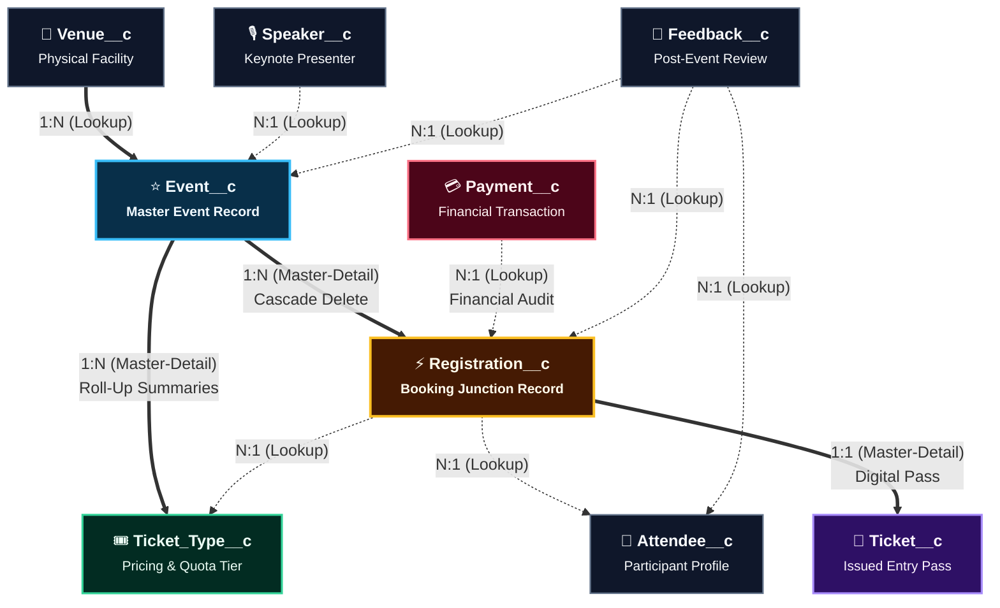

# ROLE 1: Data Model, Relationships, Validation Rules & Complete Project Workflow
## Dedicated Technical Defense & Viva Manual

---

## 📌 Role Objective
You are the **Data Architect & Lead Workflow Engineer**. Your responsibility during the evaluation/viva is to explain:
1. The relational database schema (ERD), entity definitions, and relationship types (**9 Custom Objects + 3 Custom Metadata Types**).
2. Roll-up summary fields vs. trigger-calculated fields.
3. Master validation rules (error condition formulas, locations, and business purposes).
4. The full end-to-end lifecycle workflow of events, attendees, dynamic approvals, and tickets.

---

# 1. Entity Relationship Diagram (ERD) & Schema Architecture

```
     ┌──────────────┐
     │   Venue__c   │
     └──────┬───────┘
            │ 1
            │
            │ N (Lookup)
     ┌──────┴───────┐                         ┌──────────────┐
     │   Event__c   │◀───────(Lookup)─────────│  Speaker__c  │
     └──────┬───────┘                         └──────────────┘
            │
            ├─────────────────────────────────────────┐
            │ 1 (Master-Detail)                       │ 1 (Master-Detail)
            ▼ N                                       ▼ N
     ┌──────────────┐                          ┌────────────────┐
     │Ticket_Type__c│◀────────(Lookup)─────────│ Registration__c│◀──────(Lookup)──────┐
     └──────────────┘                          └──────┬─────────┘                     │
                                                      │                        ┌──────┴───────┐
                                                      ├─────────────┬──────────┤  Attendee__c │
                                                      │ 1 (M-D)     │ 1(Lookup)└──────┬───────┘
                                                      ▼ N           ▼ N               │
                                               ┌──────────────┐┌──────────────┐       │
                                               │   Ticket__c  ││  Payment__c  │       │
                                               └──────────────┘└──────────────┘       │
                                                      ▲                               │
                                                      │ (Lookup)                      │
                                               ┌──────┴───────────────────────────────┘
                                               │         Feedback__c                  │
                                               │ (Lookups: Registration, Event, Attendee)
                                               └──────────────────────────────────────┘
```

### Visual ER Diagram Flowchart (Mermaid)
> 🔗 **Exported Transparent Visuals for Presentation:**  
> • [`erd_diagram_flowchart.png`](file:///c:/Users/10pri/Downloads/evmos%20saleforce/presentation/visuals/erd_diagram_flowchart.png) (High-Res 2x Transparent PNG)  
> • [`erd_diagram_flowchart.svg`](file:///c:/Users/10pri/Downloads/evmos%20saleforce/presentation/visuals/erd_diagram_flowchart.svg) (Infinite-Scale Vector SVG)



### Relationship Summary Table:
| Child Object | Parent Object | Relationship Type | Delete Behavior | Enables Roll-Up Summary on Parent? |
|---|---|---|---|:---:|
| `Ticket_Type__c` | `Event__c` | **Master-Detail** | Cascade Delete | **YES** (`Total_Capacity__c`, `Booked_Seats__c`) |
| `Registration__c` | `Event__c` | **Master-Detail** | Cascade Delete | **YES** |
| `Registration__c` | `Ticket_Type__c` | **Lookup** | Restrict Delete | No (Maintained in Apex) |
| `Registration__c` | `Attendee__c` | **Lookup** | Set Null | No |
| `Ticket__c` | `Registration__c` | **Master-Detail** | Cascade Delete | **YES** |
| `Payment__c` | `Registration__c` | **Lookup** | Restrict Delete | No (Retained for financial audit) |
| `Feedback__c` | `Registration__c` | **Lookup** | Restrict Delete | No |
| `Feedback__c` | `Event__c` | **Lookup** | Set Null | No |
| `Feedback__c` | `Attendee__c` | **Lookup** | Set Null | No |
| `Speaker__c` | `Event__c` | **Lookup** | Set Null | No |
| `Event__c` | `Venue__c` | **Lookup** | Restrict Delete | No |

---

# 2. Detailed Object Dictionary & Relationships

### 1. `Event__c` (Master Event Record)
- **Purpose:** Core table storing event lifecycle metadata, budget, venue link, and capacity.
- **Key Relationships:**
  - `Venue__c` (Lookup to `Venue__c`): Selected venue hosting the event.
  - `Organizer__c` (Lookup to `User`): The event organizer in charge.
  - `Approved_By__c` (Lookup to `User`): The manager/executive who approved the event budget.
- **Roll-up Summary & Capacity Fields:**
  - `Total_Capacity__c` (Roll-up Summary: `SUM(Ticket_Type__c.Quota__c)`): Total seats across all ticket tiers.
  - `Booked_Seats__c` (Roll-up Summary: `SUM(Ticket_Type__c.Booked_Seats__c)`): Total registered attendees.
  - `Available_Seats__c` (Formula: `Total_Capacity__c - Booked_Seats__c`): Real-time seats left.
- **Lifecycle Picklists:**
  - `Category__c`: `Conference`, `Workshop`, `Training`, `Hackathon`, `Concert`, `Executive Summit`, `Webinar`, `Meetup`, `Other`. (Drives dynamic multi-tier approval thresholds).
  - `Approval_Status__c`: `Draft`, `Pending Approval`, `Approved`, `Rejected`.
  - `Publication_Status__c`: `Unpublished`, `Published`.
  - `Registration_Status__c`: `Not Open`, `Open`, `Closed`, `Sold Out`.

### 2. `Venue__c` (Physical Facility)
- **Purpose:** Physical locations where events occur.
- **Key Fields:** `Name`, `Address__c`, `City__c`, `Venue_Capacity__c` (Maximum physical safety ceiling), `Contact_Person__c`, `Contact_Phone__c`.

### 3. `Ticket_Type__c` (Ticket Tier Configuration)
- **Relationship:** **Master-Detail** to `Event__c`.
- **Purpose:** Defines seat quotas and prices (e.g. VIP ₹5,000, General ₹2,000, Student ₹800).
- **Key Fields:**
  - `Price__c` (Currency in ₹). Locked once `Event__r.Registration_Status__c = 'Open'`.
  - `Quota__c` (Number): Allocated seats for this specific tier. Locked once registration opens.
  - `Booked_Seats__c` (Number): Incremented/decremented atomically by `RegistrationTriggerHandler.cls`.
  - `Available_Seats__c` (Formula: `Quota__c - Booked_Seats__c`).
  - `Status__c`: `Available`, `Sold Out`, `Closed`.

> **Viva Note on `Ticket_Type__c.Booked_Seats__c`:**  
> Since `Registration__c` has a **Lookup** relationship to `Ticket_Type__c` (Salesforce limits custom objects to 2 Master-Detail relationships, and `Registration__c` already has Master-Detail to `Event__c`), declarative Roll-Up Summary is not possible on `Ticket_Type__c`. Therefore, `Booked_Seats__c` is a **Number (18, 0)** field maintained atomically in Apex via `RegistrationTriggerHandler.cls` using `SELECT ... FOR UPDATE` row-level locking.

### 4. `Attendee__c` (Customer / Participant Identity)
- **Purpose:** Represents individual participants independently of specific events.
- **Key Fields:** `Name`, `Email__c` (Unique identifier), `Phone__c` (10-digit mobile), `Organization__c`, `User__c` (Lookup to `User` for community/portal security).

### 5. `Registration__c` (Booking Junction)
- **Relationship:** **Master-Detail** to `Event__c`, **Lookup** to `Ticket_Type__c`, **Lookup** to `Attendee__c`.
- **Purpose:** Connects an attendee to an event and selected ticket type.
- **Key Fields:**
  - `Booking_Group_Id__c` (External ID): Groups multi-seat orders together (e.g., `GRP-1725530000-842`).
  - `Booked_Price__c`: Locked-in price snapshot at time of purchase in ₹.
  - `Registration_Status__c`: `Pending`, `Confirmed`, `Cancelled`, `Rejected`. Default: `Pending`.
  - `Confirmation_Status__c`: `Not Sent`, `Sent`, `Failed`. Default: `Not Sent`. (Tracks notification email dispatch).
  - `Feedback_Submitted__c` (Checkbox): Prevents duplicate survey responses.

### 6. `Ticket__c` (Issued Entry Pass)
- **Relationship:** **Master-Detail** to `Registration__c`.
- **Key Fields:** `Name` (Autonumber: `TKT-{00000}`), `Issue_Date_Time__c`, `Ticket_Status__c` (`Active`, `Checked In`, `Cancelled`).

### 7. `Payment__c` (Financial Transaction)
- **Relationship:** **Lookup** to `Registration__c` (Audit permanence: not cascade deleted).
- **Key Fields:**
  - `Amount__c` (Currency in ₹). Validated against `Registration__r.Booked_Price__c`.
  - `Payment_Method__c`: `UPI`, `Card`, `Net Banking`, `Cash`.
  - `Payment_Status__c`: `Pending`, `Successful`, `Failed`, `Refunded`. Default: `Successful`.
  - `Transaction_Reference__c`: Unique gateway/UPI reference. Mandatory when status is `Successful`.

### 8. `Speaker__c` (Keynote Presenters)
- **Relationship:** **Lookup** to `Event__c`.
- **Key Fields:** `Name`, `Bio__c`, `Email__c`, `Phone__c`, `Expertise__c`, `Organization__c`, `Status__c` (`Active`, `Inactive`).

### 9. `Feedback__c` (Post-Event Reviews)
- **Relationship:** **Lookup** to `Event__c`, **Lookup** to `Attendee__c`, **Lookup** to `Registration__c`.
- **Key Fields:** `Overall_Rating__c` (1-5), `Venue_Rating__c` (1-5), `Speaker_Rating__c` (1-5), `Event_Experience__c` (1-5), `Comments__c`.

---

# 3. Custom Metadata Types (3 CMDTs)

1. **`Approval_Matrix__mdt` (Dynamic Category Delegation of Authority):**
   - Fields: `Category__c`, `Auto_Approve_Limit__c`, `Manager_Approve_Limit__c`, `Requires_Finance_Signoff__c`.
   - Used by `EventApprovalService.cls` to dynamically route approval without hardcoded thresholds.
2. **`Approval_Settings__mdt` (Global Fallback Configuration):**
   - Fields: `Budget_Threshold__c` (Baseline fallback limit if category matrix record is not defined).
3. **`Payment_Gateway_Config__mdt` (Payment Gateway & UPI Sandbox):**
   - Fields: `Gateway_Provider__c`, `Environment__c`, `UPI_VPA__c`, `Auto_Verify_Seconds__c` (10s countdown for demo).

---

# 4. Master Declarative Validation Rules Matrix (20 Rules)

| # | Object | Rule API Name | Error Condition Formula | Business Purpose |
|---|---|---|---|---|
| 1 | **Event** | `End_After_Start` | `Start_Date_Time__c >= End_Date_Time__c` | Prevents backwards chronological scheduling. |
| 2 | **Event** | `Budget_Required_On_Submit` | `ISBLANK(Proposed_Budget__c) && ISPICKVAL(Approval_Status__c, "Pending Approval")` | Enforces budget presence before approval submission. |
| 3 | **Event** | `No_Publish_Before_Approved` | `ISPICKVAL(Publication_Status__c, "Published") && NOT(ISPICKVAL(Approval_Status__c, "Approved"))` | Restricts unapproved events from being published to the public. |
| 4 | **Event** | `No_Booking_On_Rejected_Or_Cancelled` | `(ISPICKVAL(Approval_Status__c, "Rejected") \|\| ISPICKVAL(Approval_Status__c, "Cancelled")) && ISPICKVAL(Publication_Status__c, "Published")` | Prevents publishing rejected or cancelled events. |
| 5 | **Event** | `Rejection_Reason_Required` | `ISPICKVAL(Approval_Status__c, "Rejected") && ISBLANK(Rejection_Reason__c)` | Mandates written feedback when a manager rejects a budget. |
| 6 | **Event** | `No_Self_Approval` | `ISPICKVAL(Approval_Status__c, "Approved") && NOT(ISBLANK(Approved_By__c)) && Approved_By__c = Organizer__c` | Separation of duties: Organizers cannot approve their own events. |
| 7 | **Venue** | `Capacity_Positive` | `Venue_Capacity__c <= 0` | Enforces physical venue capacity must be greater than zero. |
| 8 | **Ticket Type**| `No_Price_Change_After_Registration_Open`| `ISCHANGED(Price__c) && ISPICKVAL(Event__r.Registration_Status__c, "Open")` | Price lock: Protects attendees from mid-sale price gouging. |
| 9 | **Ticket Type**| `No_Quota_Change_After_Registration_Open`| `ISCHANGED(Quota__c) && ISPICKVAL(Event__r.Registration_Status__c, "Open")` | Inventory lock: Prevents altering quotas during active sales. |
| 10| **Ticket Type**| `Quota_Not_Below_Booked_Seats`| `Quota__c < Booked_Seats__c` | Prevents reducing ticket quota below already confirmed seats. |
| 11| **Registration**| `Ticket_Type_Must_Belong_To_Event`| `Ticket_Type__r.Event__c <> Event__c` | Relational integrity: Prevents cross-event ticket assignments. |
| 12| **Registration**| `No_Reg_On_Unpublished_Or_Closed_Events`| `ISNEW() && NOT(ISPICKVAL(Event__r.Registration_Status__c, "Open"))` | Blocks registrations on draft, cancelled, or sold-out events. |
| 13| **Registration**| `Booked_Price_Required`| `ISNEW() && ISBLANK(Booked_Price__c)` | Ensures financial snapshot is captured upon registration inception. |
| 14| **Payment** | `Amount_Matches_Registration_Booked_Price`| `Amount__c <> Registration__r.Booked_Price__c` | Prevents underpayment, overpayment, or tampering. |
| 15| **Payment** | `Txn_Ref_Required_When_Successful`| `ISPICKVAL(Payment_Status__c, "Successful") && ISBLANK(Transaction_Reference__c)` | Enforces audit trail reference code on all settled transactions. |
| 16| **Attendee**| `Valid_Email_Format`| `AND(NOT(ISBLANK(Email__c)), NOT(REGEX(Email__c, "^[a-zA-Z0-9._%+-]+@[a-zA-Z0-9.-]+\\.[a-zA-Z]{2,}$")))` | Enforces standard RFC email syntax. |
| 17| **Attendee**| `Valid_Phone_Number`| `AND(NOT(ISBLANK(Phone__c)), NOT(REGEX(Phone__c, "^[0-9]{10}$")))` | Enforces standard 10-digit telephone format. |
| 18| **Feedback**| `Rating_Range` | `Overall_Rating__c < 1 \|\| Overall_Rating__c > 5` | Standardizes satisfaction score scale (1 to 5 stars). |
| 19| **Feedback**| `No_Feedback_Before_Event_Ends`| `Registration__r.Event__r.End_Date_Time__c > NOW()` | Prohibits reviews before the event has physically concluded. |
| 20| **Feedback**| `One_Feedback_Per_Registration`| `Registration__r.Feedback_Submitted__c = TRUE` | Enforces strict one-review-per-ticket policy. |

---

# 5. Full End-to-End Project Workflow

### Phase 1: Event Creation & Dynamic Budget Routing
1. **Event Organizer** opens Organizer Dashboard LWC and clicks **"+ Create Event"**.
2. **Screen Flow (`Event_Creation_Screen_Flow`)** collects Event Details, selects Venue, and embeds **`ticketTypeCollector` LWC** to dynamically add ticket tiers.
3. **Safety Capacity Check:** Apex trigger ensures $\sum(\text{Ticket Quotas}) \le \text{Venue Capacity}$.
4. **Dynamic Delegation of Authority Routing (`EventApprovalService.cls`):**
   - Evaluates Category and Proposed Budget against `Approval_Matrix__mdt`:
     - **Tier 1 (Auto-Approve):** Budget $\le$ Category Auto Limit $\rightarrow$ Instant `Approved`.
     - **Tier 2 (Manager Review):** Budget $\le$ Manager Limit $\rightarrow$ Routes to Event Manager queue.
     - **Tier 3 (Executive Signoff):** Budget $>$ Manager Limit $\rightarrow$ Routes to Finance / Executive signoff.
   - If rejected, Manager must provide `Rejection_Reason__c`; Organizer can modify and resubmit.

### Phase 2: Inventory Lockdown & Publication
1. Organizer clicks **"Publish Event"** $\rightarrow$ `Publication_Status__c = 'Published'`, `Registration_Status__c = 'Open'`.
2. Validation rules lock ticket prices and quotas against tampering during active registration.

### Phase 3: Attendee Discovery & Multi-Ticket Booking
1. Attendee opens **Event Booking Portal** (`attendeeEventBooking` LWC).
2. Live search filters approved & published events by category and city.
3. Attendee clicks **"Book Tickets"**, chooses a ticket tier, and uses the multi-seat counter (`[-] 2 [+]`).
4. Attendee fills out individual guest names, emails, and phone numbers for each pass.
5. Attendee clicks **"Reserve Tickets"**:
   - Calls `EventBookingController.bookMultipleTickets()`.
   - Executes `SELECT ... FOR UPDATE` row-level lock on `Ticket_Type__c` to eliminate race conditions.
   - Atomically inserts $N$ `Registration__c` records with shared `Booking_Group_Id__c`.

### Phase 4: Simulated UPI QR Payment & Pass Issuance
1. LWC component `paymentQrVerification` displays a realistic UPI QR code with a **170px SVG countdown ring** (10-second auto-verification timer).
2. Upon countdown expiry or "I Have Paid" click:
   - `EventBookingController.confirmPayment()` executes with idempotency guard.
   - Atomically flips all registrations in group to `Confirmed`.
   - Creates `Payment__c` record (`Status = 'Successful'`).
3. **Record-Triggered Flow (`Post_Registration_Automation`)** fires:
   - Issues official `Ticket__c` records (`TKT-XXXXX`).
   - Logs Completed Task on Event for audit trail.
   - Dispatches confirmation email with ticket pass details.
   - Sets `Confirmation_Status__c = 'Sent'`.

### Phase 5: Gate Check-in & Barcode Entry Pass
1. Attendee opens **"My Tickets"** tab and clicks **"View / Print Pass"**, launching the Visualforce PDF pass (`PrintableTicket.page`) displaying the primary booker, event details, machine-readable barcode, and complete guest roster.
2. At the venue gate, the registration team scans the barcode:
   - System validates ticket is `Active` and flips status to `Checked In`.

### Phase 6: Background Automation & Post-Event Feedback
1. **Scheduled Flow (`Event_Reminder_Scheduled_Flow`):** Runs daily, 24 hours prior to event start. Uses bulkified in-memory string collection to send automated reminders consuming only 1 email invocation.
2. **Scheduled Flow (`Post_Event_Feedback_Scheduled_Flow`):** Runs 10 hours after event concludes, dispatching survey links to confirmed attendees.
3. Attendee submits 1-5 star ratings; database trigger flips `Feedback_Submitted__c = TRUE` to prevent duplicate submissions.
4. Executive Dashboards update with live NPS, attendance, and revenue analytics.

---

# 6. Viva / Oral Exam Q&A for Role 1

### Q1: "Why did you use Master-Detail for `Ticket_Type__c` and `Registration__c`, but Lookup for `Payment__c` and `Attendee__c`?"
> **Answer:** *"Master-Detail on `Ticket_Type__c` and `Registration__c` to `Event__c` enables native declarative Roll-Up Summary fields (`Total_Capacity__c`, `Booked_Seats__c`) on `Event__c` with zero CPU/SOQL overhead. It also ensures cascading deletion if an unapproved draft event is deleted. In contrast, `Payment__c` must use Lookup for financial audit compliance: payment transaction logs must never be deleted if an event or registration is modified. `Attendee__c` uses Lookup because attendees exist independently of individual events and can attend dozens of events over their lifetime."*

### Q2: "Why is `Booked_Seats__c` on `Ticket_Type__c` a Number field rather than a Roll-Up Summary?"
> **Answer:** *"In Salesforce, Roll-Up Summary fields are strictly limited to Master-Detail relationships. While `Ticket_Type__c` is detail to `Event__c`, `Registration__c` has a Lookup relationship to `Ticket_Type__c` (Salesforce limits each object to a maximum of 2 Master-Detail relationships, and `Registration__c` already has Master-Detail to `Event__c` and `Ticket__c`). Therefore, `Ticket_Type__c.Booked_Seats__c` is a Number field maintained atomically in Apex via `RegistrationTriggerHandler.cls` using `SELECT ... FOR UPDATE` row locking to prevent race conditions."*

### Q3: "How does your system prevent two users from booking the last available VIP ticket at the exact same millisecond?"
> **Answer:** *"Declarative validation rules cannot prevent race conditions because they evaluate against the start-of-transaction database snapshot. If User A and User B click Book at the same millisecond, both validation rules evaluate `Available_Seats__c = 1` as valid, resulting in overbooking. Our system solves this in `EventBookingController.cls` using `SELECT Quota__c, Booked_Seats__c FROM Ticket_Type__c WHERE Id = :ticketTypeId FOR UPDATE`. The `FOR UPDATE` keyword locks the database row exclusively for User A. User B's thread is paused until User A's transaction commits. When User B wakes up, the live read shows `Available_Seats__c = 0`, and User B is returned a clean 'Sold Out' notification."*

### Q4: "How is your Budget Approval process dynamic rather than hardcoded?"
> **Answer:** *"Instead of hardcoding a single static ₹2,00,000 threshold, our system uses `Approval_Matrix__mdt` Custom Metadata. Our Apex service `EventApprovalService.cls` queries the matrix by event category (e.g. Workshop vs Hackathon vs Executive Summit) using SOQL-free custom metadata methods. Each category has its own `Auto_Approve_Limit__c` and `Manager_Approve_Limit__c`. Low budgets auto-approve instantly, mid-tier budgets route to the Event Manager, and large budgets automatically escalate to Finance and Executive signoff."*
